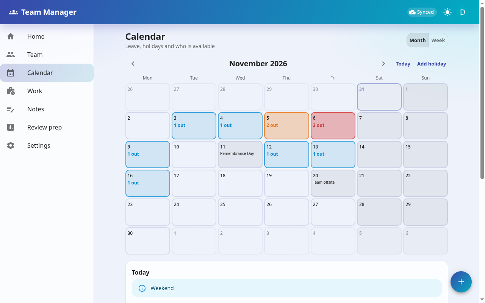
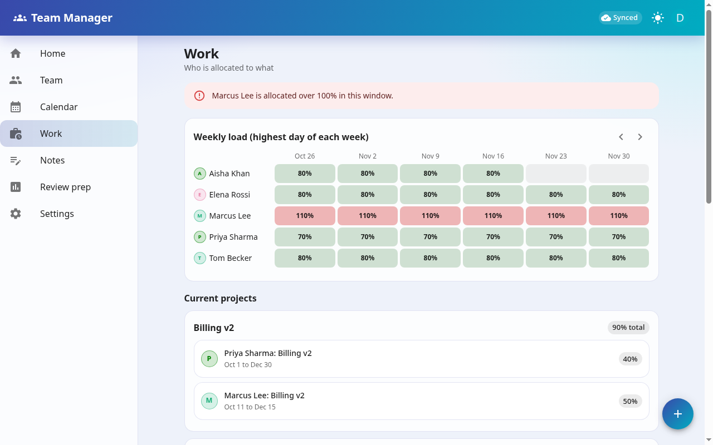
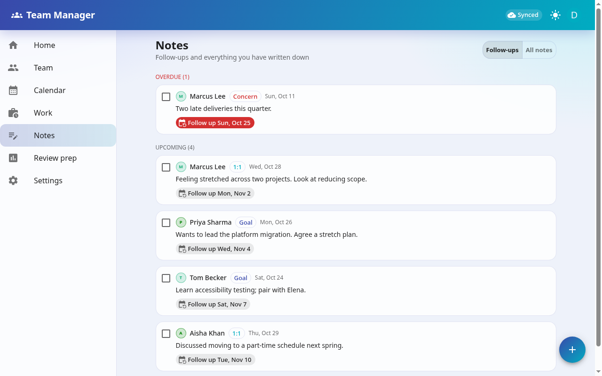
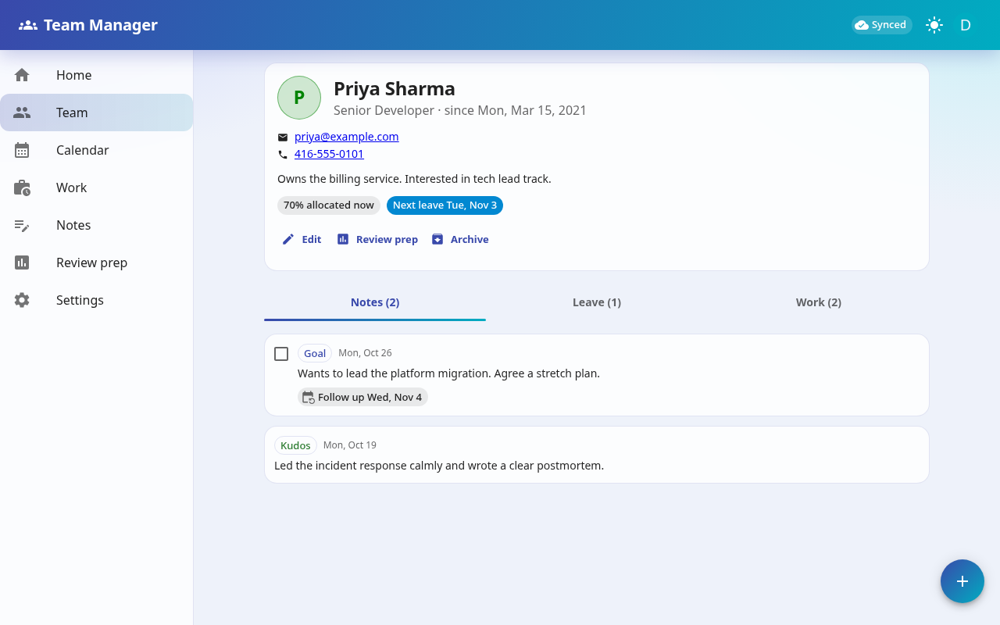
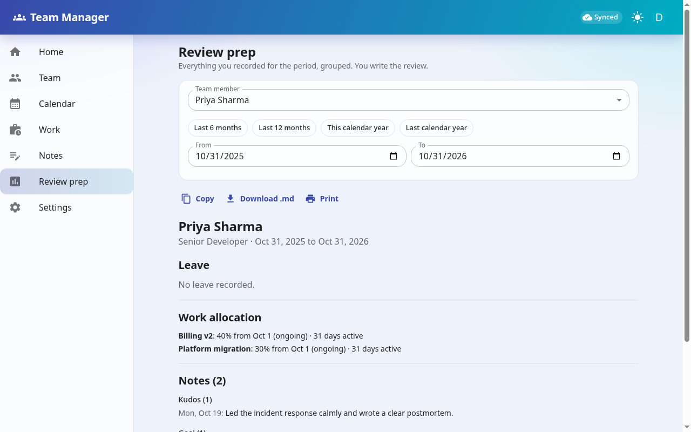
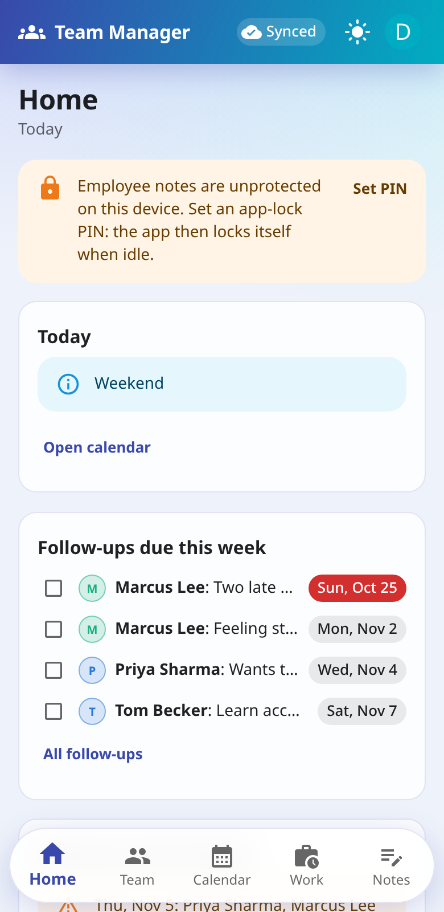
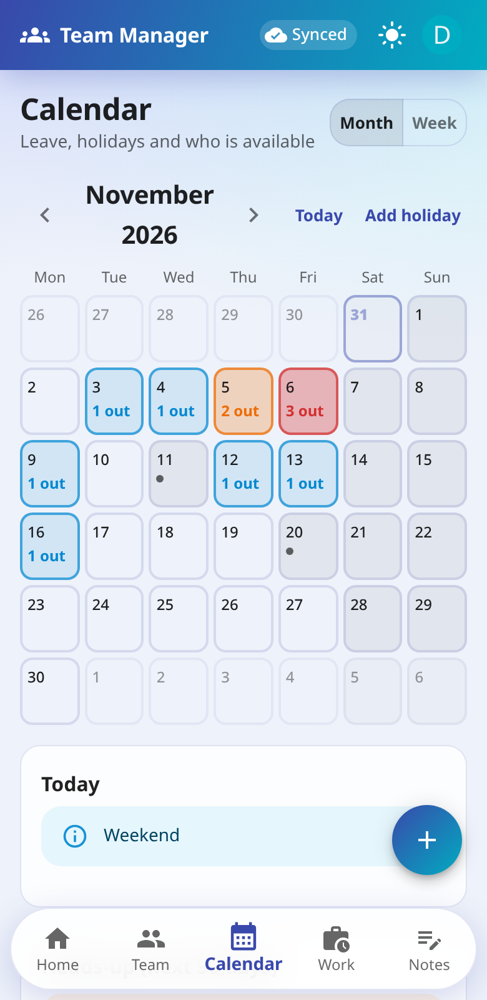
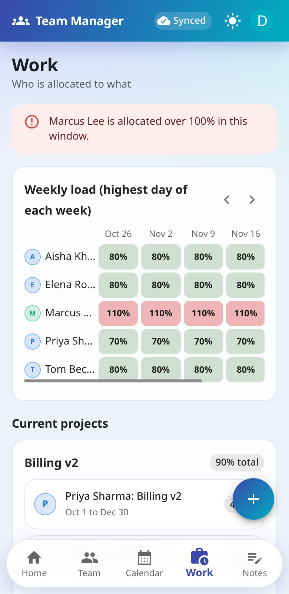
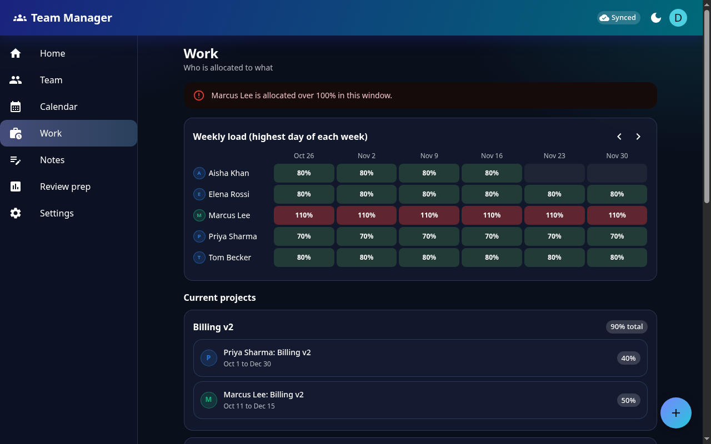

# Team Manager

A private PWA for a manager to run a team: people, a leave calendar that highlights conflicts and shows who is
available, work allocation, notes with follow-ups, and review-prep summaries built only from your own notes.
Contact details per person, daily PIN-encrypted JSON backups with restore, custom holidays. Username + password sign-in (no email, no Google), offline-first, optional PIN lock with encrypted local cache.

Spring Boot 4 / Java 25 / JDBC / Postgres backend, React (JSX) + MUI frontend, Gradle multi-project, podman.
`CLAUDE.md` has the architecture; `docs/usage-and-deployment.html` is the people-facing guide.

## Screenshots

Demo data only. The calendar shades days by how many people are out (blue = one, orange = two, red = three or more) and leaves weekends and holidays alone.



| Work allocation | Notes and follow-ups |
| --- | --- |
|  |  |
| **Team member** | **Review prep** |
|  |  |

Works as a phone-sized PWA and has a dark theme:

| Home | Calendar | Work |
| --- | --- | --- |
|  |  |  |



## Run it locally

```bash
systemctl --user start podman.socket          # only needed for tests
podman kube play podman/postgres.yaml         # dev Postgres on host port 5434 (team/team/team)
./gradlew :backend:bootRun                    # builds the frontend, serves app + API on http://localhost:8081/team/
./gradlew :backend:test                       # integration tests (Testcontainers via podman)
```

Node is never installed on the host: every npm command runs in a `node:22` podman container through Gradle.

## Deploy (Raspberry Pi / any podman host)

1. `./gradlew :backend:bootJar`
2. `podman build -f podman/Containerfile -t localhost/team-management:latest .`
3. `cp podman/secrets.example.yaml podman/secrets.yaml`, fill in the DB password and Cloudflare tunnel token, `chmod 600` it.
4. `podman kube play podman/secrets.yaml podman/team-pod.yaml`
5. Point the tunnel's public hostname at `http://localhost:8081` (the app lives under `/team/`).
6. Create your account, then set `APP_PASSWORD_SIGNUP` to `false` in `podman/team-pod.yaml` and replay the pod.
7. Encrypted app backups land in the backup dir (`APP_BACKUP_DIR`, mount a volume at `/backups` and make it writable for uid 10001: `podman unshare chown 10001:10001 <host dir>`); add that dir to your own backups too. They are unreadable without your PIN.
8. Cron `scripts/backup-db.sh` (nightly dump, keeps 14 days; the container is `team-postgres`) and start the pod at boot
   (`podman generate systemd` / quadlet).

The PIN lock encrypts with WebCrypto, which browsers only offer over **https** (or localhost). The tunnel gives you https.
